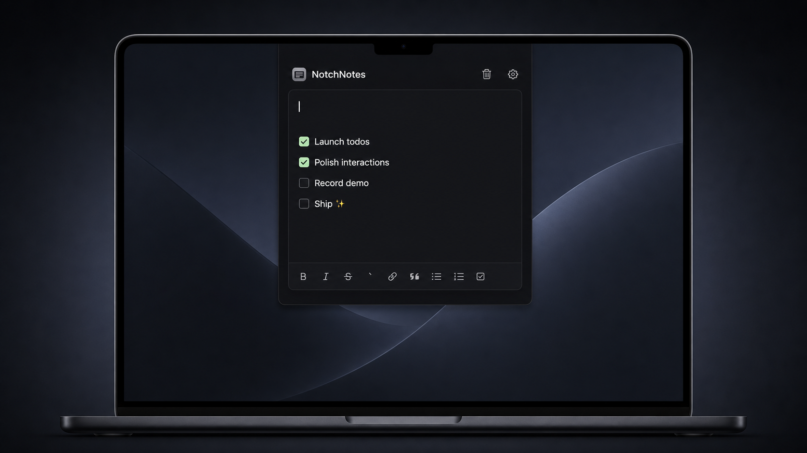

# NotchNotes



NotchNotes 是一款原生 macOS 刘海笔记应用。默认点按屏幕顶部的刘海区域展开界面，即可快速记录 Markdown 笔记、暂存文件或防止 Mac 自动休眠。

## 下载与安装

- [下载最新版](https://github.com/oil-oil/NotchNotes/releases/latest/download/NotchNotes.zip)
- [打开产品官网](https://oil-oil.github.io/NotchNotes/)

下载包同时支持 Apple Silicon 和 Intel，要求 macOS 14 或更高版本。

1. 解压 `NotchNotes.zip`，将 `NotchNotes.app` 移入“应用程序”。
2. 首次启动时右键点击应用，选择“打开”。
3. 如果 macOS 仍然拦截，请前往“系统设置 → 隐私与安全性”，点击“仍要打开”。

当前公开构建使用临时签名，尚未经过 Apple 公证，因此首次启动会出现安全提示。正式免提示分发需要 Developer ID Application 证书和 Apple 公证。

## 使用

启动后，使用鼠标左键点按刘海区域展开界面；普通鼠标经过或点按刘海周围不会展开。无刘海显示器使用屏幕顶部中央的模拟刘海区域。设置菜单的“触发方式”仍可切换为“悬停”，此时移入刘海区域即可展开。

首次升级到点按默认版本时，已有触发设置会统一切为“点按”；之后手动选择的触发方式会保存，重启不会再次重置。

展开后可直接记录 Markdown 笔记。将文件拖到刘海附近仍会自动展开，再放入底部暂存区即可快速取用，支持拖到 Finder、应用或网页上传区。暂存区只保留文件引用，不会移动或删除原文件。

在设置菜单中可开启“久坐提醒”。挂件展示默认关闭，可通过“展示挂件”独立控制；隐藏时平时不占用刘海下方空间，到点仍会临时出现并展示提醒。默认每 45 分钟提醒一次，并提供立即活动、5 分钟后提醒、跳过、暂停及恢复。提醒间隔可选 30、45、60 或 90 分钟，活动计时可选 1、2、3 或 5 分钟；锁屏或系统睡眠后不会补发旧提醒。

底栏 Markdown 操作支持键盘快捷键：粗体 `⌘B`、斜体 `⌘I`、删除线 `⌘⇧X`、行内代码 `⌘⇧C`、链接 `⌘K`、引用 `⌘⇧>`、项目列表 `⌘⇧8`、编号列表 `⌘⇧7`、待办列表 `⌘⇧9`。将鼠标悬停在按钮上也可查看对应键位。

笔记和暂存记录保存在本机，不会因覆盖安装应用而删除。

## 本地运行

```bash
swift run NotchNotes
```

## 构建发布包

```bash
./Scripts/package-app.sh
open dist.noindex/NotchNotes.app
```

脚本会生成 Apple Silicon + Intel 通用应用、ZIP 附件和 SHA-256 校验文件。正式签名和公证时可设置：

```bash
SIGN_IDENTITY="Developer ID Application: Your Name (TEAMID)" \
NOTARY_PROFILE="notary-profile" \
./Scripts/package-app.sh
```

## 自动发布

- 每次推送 `main`，GitHub Actions 会先运行测试，再构建通用应用，并自动覆盖 `latest` Release。
- 官网下载按钮固定指向 `releases/latest`，因此不需要手动修改下载地址。
- 推送 `v*` 版本标签时，仍会生成对应的版本快照 Release。
- 官网由 GitHub Pages 读取 `main` 分支的 `docs` 目录，页面修改推送后会自动部署。

如果测试或构建失败，Release 不会被覆盖，用户仍会下载上一份验证通过的版本。

## 技术栈

- Swift + AppKit：浮层、窗口层级、屏幕定位和顶部触发行为。
- SwiftUI：笔记和文件暂存界面。
- UserDefaults：轻量本地数据存储。
- MarkdownEngine：Markdown 编辑和内嵌图片。
