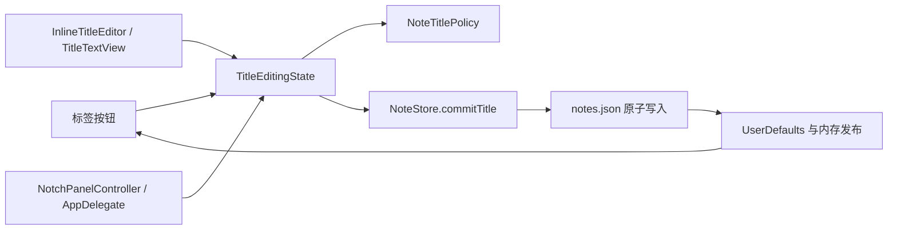

# 分页标题常显与双击重命名 — 技术设计方案

> 需求：分页标题重命名 | 状态：T1、T2 自动化验证完成，T3–T5 待实现 | 日期：2026-09-24
> 定位说明：需求级技术契约；选型出处为 [NotchNotes/docs/intent/tab-title-renaming.md](../../intent/tab-title-renaming.md)（D1–D7）。实现顺序见 [plan](../../../tasks/plan.md)，验收依据为 [SPEC](../../../SPEC.md) 与 [PRD](../../prd/PRD.md)。
> 以下为完整目标契约；当前仅 T1、T2 已实现，点击离开、完整输入法/辅助技术、删除及退出契约仍待后续任务。实施证据与阶段边界见 intent 的 T1/T2 记录。

## 一、需求与范围

### 1.1 目标

分页由圆点改成常显文字；双击原位独立命名，保存、取消、清空及失败恢复符合 SPEC AC01–AC15。

### 1.2 范围

- 包含：分页导航、可选自定义标题、原生单行输入、严格保存结果、焦点/事件协调、删除恢复及正常退出检查。
- 不包含：新服务、数据库、云同步、排序分组、导入导出、权限、批量操作、Vendor 修改或 CI 迁移。

### 1.3 需求版本

以 PRD/SPEC 为输入，按五条用户路径实现。

## 二、现状与方案概览

### 2.1 规划时基线（实施前）

- `NoteStore.swift`：`NoteTab` 无独立标题；`title(for:language:)` 从正文计算，自动标题超过 42 字符截取为 41 字符加省略号。
- `persistNow()` 先写 UserDefaults，再把完整快照排到串行队列写 `notes.json`；磁盘错误被吞掉。`flush()` 无可判定的成功结果。
- `NotebookView.swift`：`TabPagerControl` 使用圆点、`WrappingHStack` 与按圆点数量估算的 `tabRowCount`；新增文字标签必须同步替换高度计算。
- `NotchPanel.sendEvent` 在原生输入系统前消费 Esc；控制器有定时和全局 mouseUp 两条自动收起路径，菜单也能直接隐藏和新建。
- `EditorInteractionState` 查找任意第一个 `NSTextView`，并有延迟正文聚焦重试；新增标题文本视图会使这个假设失效。
- `AppDelegate` 只有 `applicationWillTerminate` 最终 flush，缺少可取消的退出检查。

### 2.2 方案摘要

使用可选标题扩展原归档。窗口持有唯一编辑会话，SwiftUI 管滚动和外观，局部 AppKit 控件管点击、原生文本和输入法。标题确认先原子落盘，成功才发布；所有离开编辑的动作共享保存门控。正文焦点与标题焦点明确隔离，不改变 MarkdownEngine。

### 2.3 拟议交互图

### 2.4 资源变更

无新增基础设施。新增四个应用内文件：`NoteTitlePolicy.swift`、`TitleEditingState.swift`、`TabPagerControl.swift`、`InlineTitleEditor.swift`，均位于 `Sources/NotchNotes/`。测试落在现有 XCTest target；不添加 package 依赖或服务资源。

## 三、数据设计

### 3.1 数据模型与生命周期

| 对象 | 变更 | 生命周期与约束 |
|---|---|---|
| `NoteTab.customTitle` | 新增 `String?`，默认 nil | nil 为自动命名；随分页归档、删除、恢复；不按名称查找分页 |
| 有效标题 | 不持久化 | 自定义标题优先，否则执行原自动标题算法 |
| `TitleEditingState.Session` | 仅内存 | 目标 UUID、initialEffectiveTitle、原始草稿、输入选区、会话 generation；成功、取消或目标删除后清除 |
| `NoteTitleError` | 仅内存枚举 | `tooLong`、`saveFailed`、`targetMissing`；映射 PRD 5.5 |

保留原 `PersistedNotes` 的 tabs、activeTabID、savedAt、原有 UserDefaults 键及归档位置。草稿不得进入归档。

### 3.2 数据库变更

无数据库、无 DDL。存在上节描述的本地 Codable 模型变更，不把本次错误标注为“无数据模型变更”。

### 3.3 数据迁移与兼容

- `customTitle` 为可选可写属性，合成 Codable 解码缺键或 null 时得到 nil；新增初始化参数默认 nil，原调用无需改写。
- 覆盖旧 `tabs.v1`、旧 `archive.v2`、旧文件归档和仅 legacy text 四种输入；只验证本次标题字段兼容，不重新设计原快照优先策略。
- 继续用 `savedAt` 选择较新的有效快照；保持已有分页 UUID、正文、选区及顺序。
- 无迁移脚本、无启动确认。旧客户端忽略新字段但重存可能丢失标题；不承诺逆向兼容写入。

## 四、安全与权限

沿用本机访问边界，无新增登录、角色、加密或网络请求。标题作为纯文本显示，不渲染 Markdown、不打开其中的 URL。测试使用隔离 UserDefaults suite 与临时归档，不读取或覆盖真实用户笔记；错误记录不包含标题、正文或完整用户路径。

## 五、接口与核心逻辑

### 5.1 标题规则契约

新增 `NoteTitlePolicy` 与同文件内的 `NoteTitleChange`、`NoteTitleError`：

| 接口 | 约定 |
|---|---|
| `singleLine(_ text: String) -> String` | 只把连续 `Character.isNewline` 或制表符段合并为一个空格，保留其他字符；供粘贴使用 |
| `normalize(_ text: String) -> String` | 调用 singleLine 后 trim `.whitespacesAndNewlines` |
| `change(for draft: String, initialEffectiveTitle: String) throws -> NoteTitleChange` | 长度用 Swift `String.count`；返回 `.unchanged` 或 `.set(String?)`，超长抛 `.tooLong` |

顺序：规范化 → 超长检查 → 空值 `.set(nil)` → 非空且等于初始有效标题 `.unchanged` → `.set(名称)`。原自动标题算法不在此重写；视觉省略文本不得传入本接口。

### 5.2 可确认的持久化提交

`NoteStore.commitTitle(for id: UUID, change: NoteTitleChange) throws`：

1. 按 UUID 验证目标存在，不存在抛 `.targetMissing`；`.unchanged` 或存储值相同直接返回，不写磁盘。
2. 复制当前 tabs，只改变候选中目标的 customTitle；编码包含当前正文、选区、activeTabID 和新 savedAt 的完整快照。
3. 取消尚未执行的正文 debounce，保存其是否需要继续写入。候选尚未赋给 `@Published tabs` 或 UserDefaults。
4. 在现有 `persistenceQueue.sync` 中调用可注入 archiveWriter。已有异步写先完成；writer 只接触不可变 Data/URL，不能同步回主线程。默认 writer 创建父目录并 `.atomic` 写文件。
5. 成功后用同一份编码数据和 savedAt 更新原 UserDefaults 键，再发布候选 tabs。旧任务即使被调度，后续只从最新内存生成快照，不得携带旧候选覆盖新标题。
6. 编码、路径缺失或写入失败统一抛 `.saveFailed`；内存和恢复副本均不接纳新名。恢复原有正文/选区的 debounce 保存需求，不丢失与改名无关的已有修改。

写入闭包为 `@Sendable (Data, URL) throws -> Void`，默认实现不受主线程 actor 隔离；原自动保存也复用该文件写入实现，但保留既有错误降级策略。避免新建通用 Repository 或改变全部正文保存协议。

原子文件成功是本次改名的提交点；UserDefaults 仍是恢复副本，不声称两个存储之间存在系统级事务，也不提供断电持久性保证。采用同步方案的取舍见 D4。

### 5.3 单一编辑会话

`TitleEditingState` 为 `@MainActor ObservableObject`，持有 store；以 `session == nil` 表示浏览态，以 session 内的 error 区分编辑、校验失败和保存失败。另留 `lastError` 在目标消失后展示提示。

| 接口 | 结果 |
|---|---|
| `begin(tabID: UUID, language: AppLanguage) -> Bool` | 同一目标已编辑时不重置；另一会话先确认，失败返回 false；目标存在则选中并捕获完整有效标题，建立新 generation |
| `updateDraft(_ value: String, selection: NSRange, isComposing: Bool)` | 保存草稿及输入选区；组字中不执行验证或文字回写；组字结束可更新长度错误 |
| `commitIfNeeded() -> Bool` | 无会话返回 true；按规则提交，成功清会话；失败保留，目标缺失清会话并提示；失败均返回 false |
| `cancel()` | 丢弃草稿，不调用存储写入；焦点恢复由调用方按原因处理 |
| `discardIfEditing(tabID: UUID)` | 仅用于已验证可执行的主动删除 |

布尔返回值表示“调用方可否继续动作”，不是异步任务句柄。添加 `isCommitting`/generation 防止 delegate 的重入提交；退出前先记下目标 UUID，再清会话，避免焦点找不到标签。调用 begin 前保存旧正文选区；会话本身不读正文 NSTextView。

### 5.4 事件分发与导航

- `NotchPanel` 增加可判定的事件预处理回调，返回 false 时不调用原鼠标回调或 `super.sendEvent`；无会话保持原行为。
- 标题输入内部的鼠标操作直接交原生文本系统。输入外的 leftMouseDown 先同步当前输入值、调用 commitIfNeeded；成功后同一个事件继续分发，失败消费该次点击及对应拖动/up，避免出现孤立 mouseUp 导致新动作。
- 标签单击、双击、固定“＋”及菜单 Cmd+N 的动作入口仍独立检查会话，覆盖键盘与辅助技术触发。无会话的重复检查为无副作用操作。
- 标签 `NSButton` 第一次点击按原生 action 选中；`mouseDown.clickCount == 2` 调用 begin 并消费第二次标签动作；已经变成输入框后双击由文本视图处理。
- 右键及 Control-click 打开分页上下文菜单时暂不提交；菜单动作按语义执行。取消菜单时，仍在输入中则继续；确已离开且应用活跃则再尝试提交，避免菜单跟踪期间的临时失焦误保存。
- 正文鼠标回调仅在预处理放行后执行，否则原 `focusEditor()` 会先夺取标题焦点。标题开始时禁止正文格式操作；真正点击正文格式按钮时，先成功结束编辑，再允许原按钮动作。

### 5.5 面板、焦点与退出

- `collapse(animated:)` 定义为显式隐藏请求：存在会话时先确认，失败不隐藏；增加内部无会话的实际收起函数，自动收起调用前必须检查 `!isEditing`。
- `handleMouseLocation`、`scheduleCollapse` 的安排和执行、全局 mouseUp 路径均检查编辑状态；开始改名即取消已安排的收起任务。保护一直维持到成功、取消或删除结束会话。
- 窗口收到 Esc 且标题有 marked text 时调用 `super.sendEvent`，交给输入法。非组字时取消会话并消费事件；没有会话才执行原 onEscape。
- `activateEditor()` 及其 0.30 秒延迟回调均检查标题会话。`EditorInteractionState` 增加 `isFocusSuspended` 与 `cancelPendingFocus()`；所有 request/retry/bind/focus 路径遵守暂停状态，标题结束不重新执行过期重试。
- 正文文本视图筛选为 `!isFieldEditor && delegate is NativeTextViewCoordinator`；现有库类可公开访问，不使用内部 NativeTextView 类名或私有 SwiftUI 层级。刷新同时维护选区观察者。
- `EditorFocusBinder` 携带当前文档 UUID；`EditorInteractionState.onDocumentSelectionChange(UUID, NSRange)` 使用通知触发时捕获的选区，过期 binding generation 不回写。`prepareForDocument` 使旧绑定失效，`currentSelectionRange(for:)` 拒绝非当前绑定 UUID；标题选区只进会话。
- T2 的窗口门控集中在同文件内 `TitlePanelInteraction`：会话开始时暂停正文焦点并取消待收起任务，定时/全局 mouseUp 使用 `performAutomaticCollapse`，正文激活使用 `performEditorActivation`；展开延迟回调携带 activation generation。
- Enter/Esc 结束后焦点回对应标签；点击离开成功时由原点击取得焦点；系统失焦无论成功失败均不激活应用。会话变化本身不得无条件 `NSApp.activate`。
- 观察 `NSApplication.didResignActiveNotification` 进行失焦提交；只监听应用失活，不把输入法候选窗口或菜单暂时夺取窗口 key 状态当成应用切换。观察者移除遵循现有生命周期。
- `AppDelegate.applicationShouldTerminate` 调控制器 `prepareForTermination() -> Bool`；合法草稿保存后返回 `.terminateNow`，失败返回 `.terminateCancel`，展示错误并等待用户修改/取消后重新请求退出。只有实际 willTerminate 才执行原 flush 和停止防休眠。
- 非按键的提交前让标题文本视图 `unmarkText()` 接受当前可见组字文本，再读取完整字符串和选区；Enter/Esc 在组字时不走此分支。

### 5.6 删除与错误

菜单删除先检查目标存在且 tabs.count > 1；若目标是正在编辑页，丢弃草稿后执行既有删除，不先保存。删除其他页时先确认当前草稿，失败不执行该动作。恢复沿用 NoteStore 原接口，不增加新的恢复 UI。

`tooLong` / `saveFailed` 保留目标与原始草稿；`targetMissing` 结束会话并显示栏级提示。错误使用 `LocalizedStringKey` 新增的 `titleTooLong`、`titleSaveFailed`、`titleTargetMissing`，文案逐字采用 PRD 5.5。

## 六、缓存设计

无缓存变更。UserDefaults 是既有持久恢复副本，不新增 Key/TTL 或标题缓存；有效标题随读取计算。

## 七、消息与异步任务

无消息队列。保留正文 0.18 秒 debounce、原文件串行队列、选区布局重试；标题确认同步排在已有文件任务后执行。新增标题 focus generation 仅用于视图挂载后取得焦点：更新或失活后过期回调不得激活应用、全选或覆盖草稿。不新增定时保存标题草稿。

## 八、外部依赖

无新增外部系统或组件库。使用已有 SwiftUI、AppKit、Foundation、Combine、MarkdownEngine、XCTest；只读取 MarkdownEngine 的公开协调器类型以识别正文，不修改 Vendor。`Package.swift` 的 target 自动包含新增 Swift 文件，无须改依赖或平台下限。

## 九、定时任务与埋点

无新增定时任务、统计埋点、分析 SDK 或远端日志。沿用现有鼠标轮询；本次只为其增加编辑态保护。调试错误只保留类别，不记录用户输入。

## 十、前端设计

### 10.1 页面与组件改动

| 文件/组件 | 责任 |
|---|---|
| `TabPagerControl.swift`（新） | 滚动条、标题按钮、固定“＋”、上下文删除及栏级错误展示 |
| `InlineTitleEditor.swift`（新） | `NSScrollView` 承载单行 `TitleTextView`；原生输入、marked text、纯文本粘贴、独立 UndoManager 与输入选区 |
| `NotebookView.swift` | 注入编辑会话和动作回调；固定分页栏高度；移出原 TabPagerControl，移除不再使用的圆点布局；正文其余结构不重写 |
| `NotchPanelController.swift` | 会话生命周期、事件预处理、焦点和窗口收起门控 |
| `Localization.swift` | 三种错误、重命名动作与操作说明的中英文映射 |

布局参数集中定义在 TabPagerControl 内：栏高 32 pt，按钮高 28 pt，上下合计 padding 4 pt，间距 6 pt，“＋”宽 28 pt；文字标签按系统 12 pt 字体测量，左右 padding 合计 16 pt，宽度限制 64–160 pt，且不超过扣除“＋”和间距后的实际区域。标题编辑沿用标签槽位宽度，超长输入在槽内水平滚动，不改变整体面板尺寸。

使用原深色面板风格，选中态背景与文字对比明确，焦点边框使用系统焦点颜色。标签单行尾部省略，tooltip 与 accessibility 名称使用完整有效标题。当前/新增/编辑目标及标题更新引起的宽度变化完成布局后滚到可见区；`.id` 始终使用分页 UUID，不用标题文字。

`TitleTextView` 为纯文本、无自动换行、无垂直滚动；有水平滚动能力且隐藏滚动条。只在新会话 generation 首次聚焦时全选，SwiftUI update 不重设 string 或选区；重挂载恢复会话草稿与选区，应用不活跃时不抢焦点。粘贴只取字符串并执行 singleLine；保存时再 trim。

### 10.2 异常、空态与权限态

- 错误以分页栏下方 overlay 展示，不撑高导航栏，文字不超出面板边界；输入仍可编辑，辅助技术能读取错误说明。
- 空草稿合法，保存后恢复默认/自动标题；不存在“空笔记集合”新状态，仍至少一页。
- 无远端加载态、权限态或新增保存中产品状态；同一同步提交防重入。
- 标签遵守原生键盘焦点遍历；Space 选择，Return 开始编辑；重命名 accessibility action 使用同一 begin。标题输入的 Cmd+A/C/X/V/Z 不调用正文编辑器，组字时不触发标题业务命令。
- 新增本地化键 `renameNote`（“重命名”/“Rename”）、`renameNoteHelp`（“双击或按 Return 编辑标题”/“Double-click or press Return to rename”）及三种错误。正文格式入口在编辑会话内暂停；会话结束恢复。

## 十一、测试设计

沿用 `Tests/NotchNotesTests/`，每片先补失败用例，再实现、回归；没有独立 HTTP 接口，因此以内部提交契约和真实文件重建测试代替接口测试。

| 需求 | 对应任务 | 自动化重点 | 人工补充 |
|---|---|---|---|
| AC01 | T1、T2 | 单击动作、双击进入同一目标 | 当前/非当前页双击 |
| AC02 | T2、T4 | 正文筛选、选区 UUID、重复 begin 不重置 | 长标题全选与正文选区保持 |
| AC03 | T2、T5 | 文件与 defaults 重建、正常退出返回值 | 退出重启及大正文样本 |
| AC04 | T2 | 连续两次 Esc 路由 | 第一次不收起 |
| AC05 | T3 | 失败后动作调用计数为 0，成功恰好 1 | Cmd+N、点击正文、切换应用 |
| AC06 | T2 | 清空、无变更、自动名不被固定 | 清空后默认名 |
| AC07 | T2 | 修改正文前后命名优先级 | 无 |
| AC08 | T2 | 50/51 字符、组合表情、重复标题 | 复杂表情输入 |
| AC09 | T2、T4 | 换行/制表符、内部空格、富文本粘贴降为纯文本 | 从外部应用粘贴 |
| AC10 | T1、T2 | 布局高度、固定入口、滚动请求 UUID | 多标签滚动与编辑可见 |
| AC11 | T2、T3、T4 | 收起保护、过期 focus 回调、marked text 路由 | 中文候选 Enter/Esc |
| AC12 | T5 | 删除当前/非当前、恢复保存标题、最后一页 | 菜单删除优先与取消菜单 |
| AC13 | T2、T4 | 四种旧数据、语言切换、完整本地化 | 中英文显示 |
| AC14 | T2、T3、T5 | 注入写入失败、原文件不变、目标缺失 | 提示和重试可达 |
| AC15 | T4 | 原生按钮 action、UndoManager 隔离、格式保护 | 键盘遍历与 VoiceOver |

环境：macOS 14+ 与 Swift 6；AppKit 测试使用进程内临时 NSPanel/NSHostingView，不运行应用真实启动入口。禁止测试调用真实 `NSApp.terminate`；用可注入的退出检查闭包测试 AppDelegate 返回值。真实 IME/VoiceOver 结果单独记录，单测不能冒充端到端验收。

## 十二、灰度、监控与回滚

### 12.1 验证与发布顺序

无服务器灰度。先逐任务 XCTest，再完整 `swift test` 与 `swift build`，最后人工完成上表原生交互验收；新功能没有全部验收前不发布。推送 main 会触发已有 GitHub 发布流程，本轮不触发。

### 12.2 监控与告警

无新增监控。验收检查标题/正文一致性、错误可恢复性、无焦点回跳及退出不丢草稿。同步落盘使用 20 页、每页约 100 KB 正文的测试样本记录耗时；这是验证样本而非新容量上限或未经测量的性能承诺。

### 12.3 回滚方案

若发现正文/选区污染、假保存成功或退出数据丢失，停止发布。由用户明确授权后回退对应功能提交；不删除用户归档或重置 UserDefaults。切回旧客户端前另存归档副本，旧应用重写可能移除 customTitle；重新使用新版本后用隔离副本验证标题、正文和分页身份。回滚不自动执行、不改写线上历史。

## 十三、待确认项与评审结论

### 13.1 待确认项

无阻塞规划的需求缺口。技术方案随 plan 一次确认，不增加单独审批节点；重点取舍为 D4 的同步磁盘确认与 D2 的局部原生控件。实际输入法、VoiceOver 和大正文耗时尚未测量，属于实现验收项目，不能写成已通过。

### 13.2 评审记录

2026-09-24：依据现有 PRD 和代码形成技术方案；当时尚未运行新功能验收。
